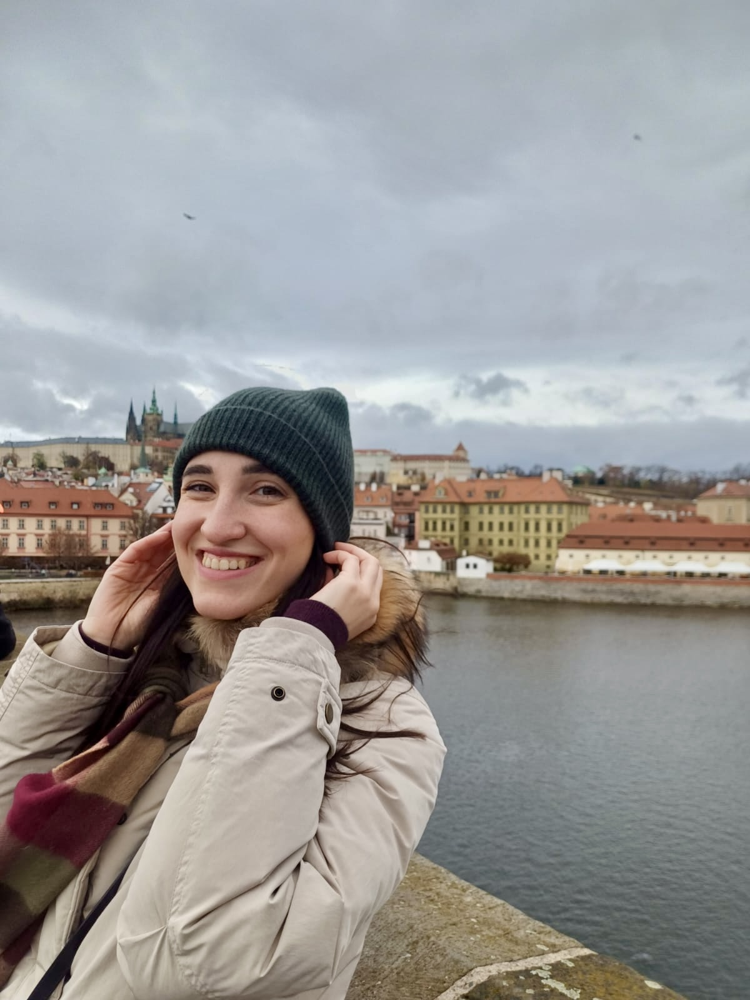

# Greta-Bertocchi.github.io

### Welcome to my page

# Hi, I'm Greta! 👋hello!

Welcome to my personal page. I am a Master's student, a retail professional, and a creative storyteller based near Milan, Italy.

## 🎓 Academic Background
I am currently pursuing a Master’s degree in **Public and Corporate Communication** at the **University of Milan** . 

I chose this path because I am deeply fascinated by how brands build meaningful relationships with people—not just through products, but through culture, values, and authentic narratives. My academic focus combines strategic communication, consumer culture, and digital media.

## 💼 Work & Experience
Alongside my studies, I work as a [Client Advisor](https://shop.brunellocucinelli.com/it-it/) here, in the luxury retail sector in Milan. Working directly with an international clientele every day is stimulating and has taught me in-depth notions.

I also manage (through volunteering) social media content and digital storytelling for a friend business, helping her translate their craftsmanship and identity into an engaging online presence.

## 🚀 Future Goals
In the future, I aim to bridge my frontline customer experience with my academic background by stepping into **corporate communication, brand experience, or guest relations** roles. My goal is to design coherent, emotionally resonant brand journeys both online and offline.

## ✨ Beyond Work & University
When I am not studying or working, you can usually find me:
* 🐾 **Spending time with animals:** I am a huge animal lover and genuinely believe they bring warmth and perspective to everyday life.
* 🎵 **Listening to music:** Music is my constant companion while I am commuting to Milan, studying, or unwinding after a busy shift.
* 🌍 **Exploring & learning:** I love traveling, discovering new places, and challenging myself with new skills (from web development basics to studying foreign languages). 
* My most recent trip? [HERE!](https://www.visitczechia.com/it-it/things-to-do/places/landmarks/cities/a-prague-beauty)

### Get to know my work and learning

- [Our class repo](github.com/ale66/learn-web)
- [Class playground](github.com/ale66/learn-web-playground-2026-2027)
- [A MA Comm refactoring project](github.com/ale66/learn-web-playground-2026-2027/Greta-Bertocchi)

P.S: I am also currently learning Russian!
